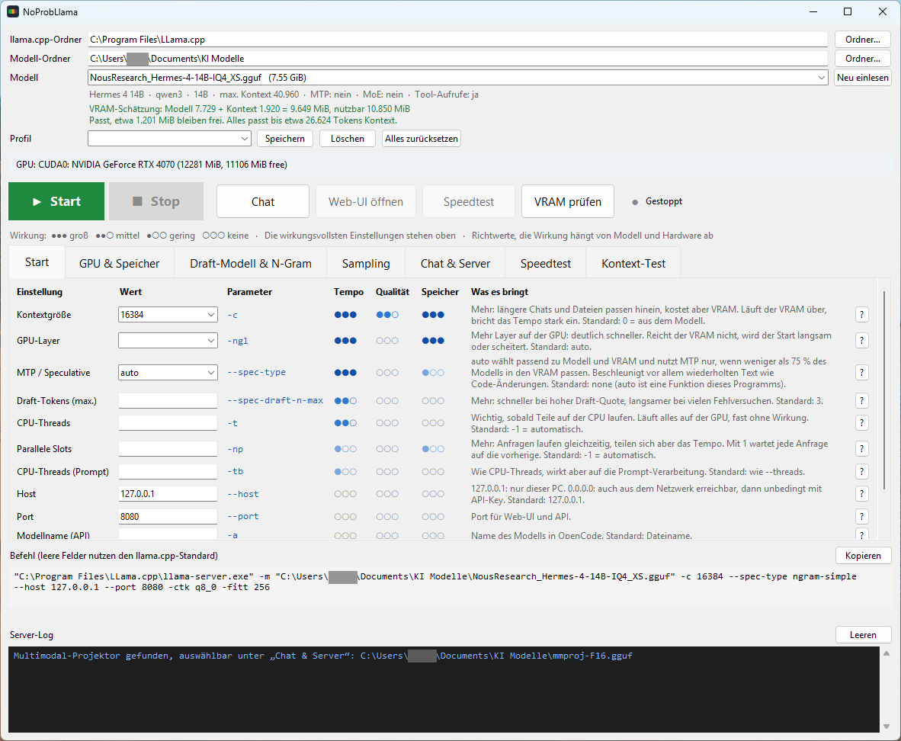
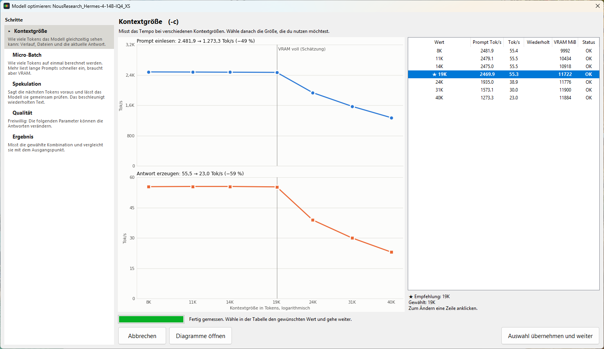
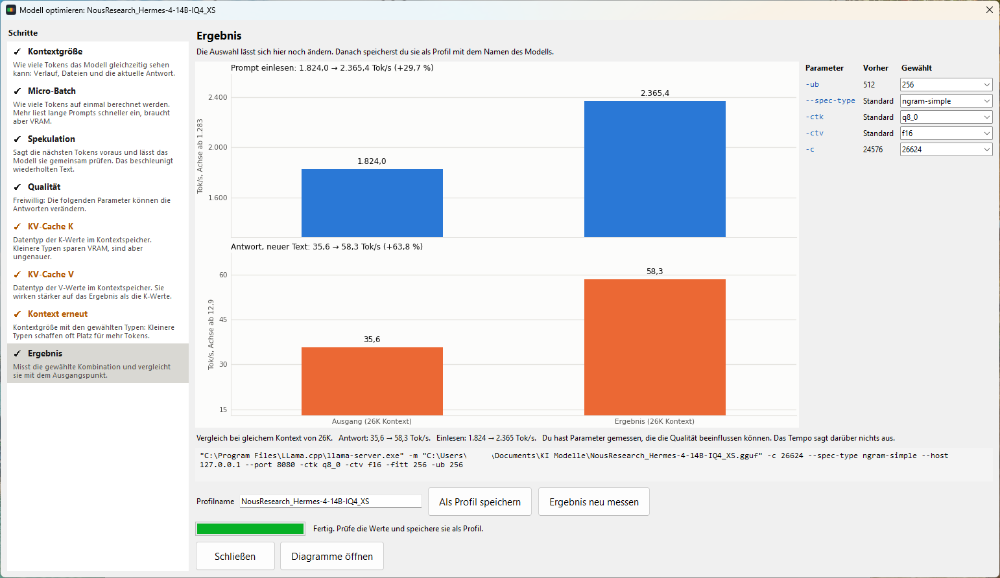
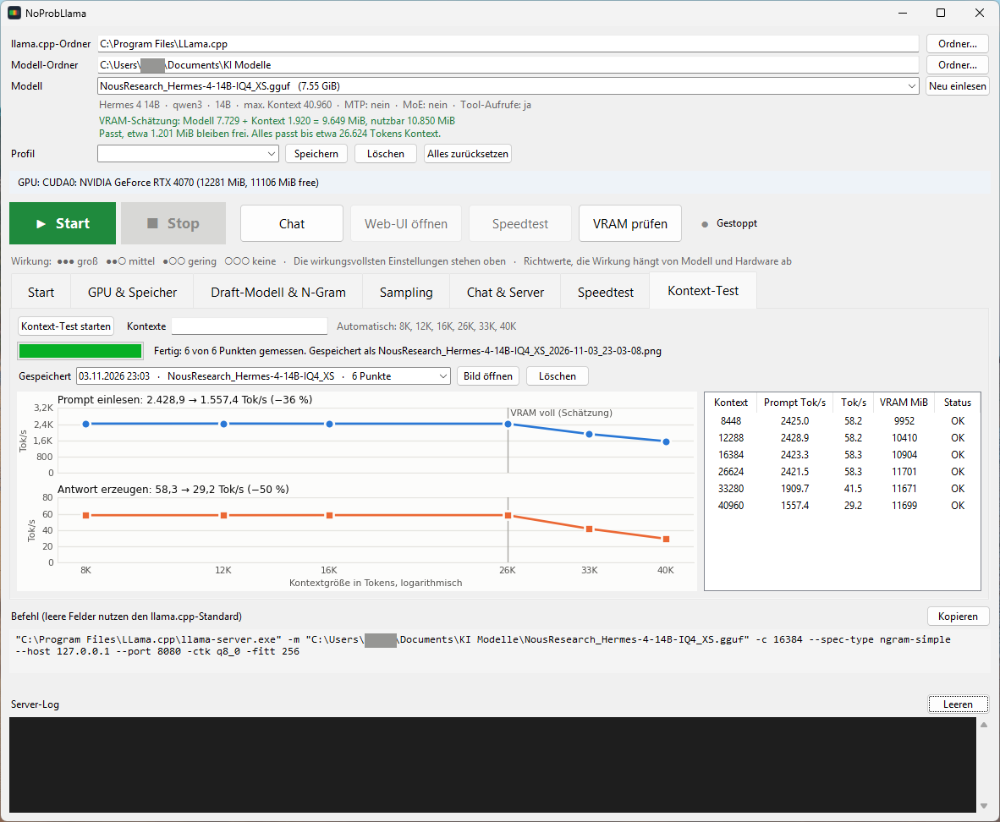
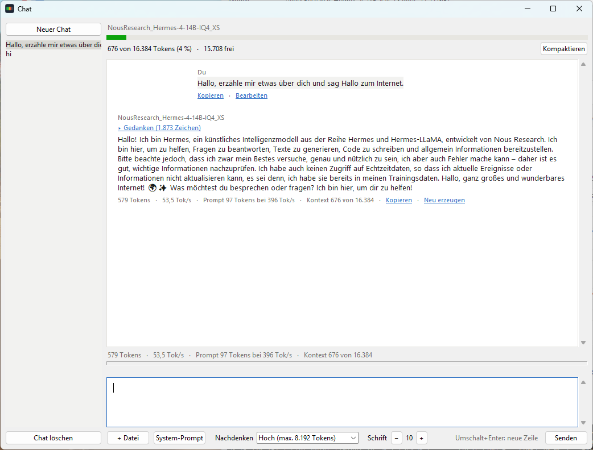

# NoProbLlama

*No problem, Llama.*

NoProbLlama ist eine Windows-Oberfläche für [llama.cpp](https://github.com/ggml-org/llama.cpp). Der Assistent **Modell optimieren** führt dich Schritt für Schritt zu den Parametern, mit denen ein lokales Sprachmodell auf deiner Grafikkarte möglichst schnell und gut läuft, und speichert sie als Profil. Das Programm schätzt außerdem den Speicherbedarf schon vor dem Start. Zum Chatten bringt es ein eigenes Fenster mit, das ohne Browser auskommt und dadurch VRAM spart. Und sobald der Server läuft, kannst du das Modell direkt in OpenCode nutzen.



## Wofür das gut ist

Auf einer Grafikkarte mit 8 bis 16 GB entscheiden oft wenige hundert MiB darüber, ob ein Modell flüssig läuft. Rutscht ein Teil davon in den Arbeitsspeicher, bricht das Tempo stark ein. Dazu kommt, dass `llama-server` rund hundert Startoptionen hat und es vom Modell abhängt, welche davon etwas bringen.

NoProbLlama beantwortet vor allem fünf Fragen:

- **Welche Einstellungen sind für mein Modell die schnellsten?** Das misst der Assistent Modell optimieren.
- **Passt das Modell mit diesem Kontext in meinen VRAM?** Das siehst du schon vor dem Start.
- **Wie viel Tempo kostet mich mehr Kontext?** Das misst der Kontext-Test.
- **Wie bleibt möglichst viel VRAM und Kontext für das Modell übrig?** Dafür gibt es das schlanke Chatfenster.
- **Wie nutze ich das Modell in OpenCode?** Modell wählen, Start drücken, fertig.

## Funktionen

### Modell optimieren

Den Assistenten startest du mit dem Knopf **Modell optimieren** in der oberen Leiste. Links steht bei jedem Schritt, was der Parameter bedeutet.



1. **Kontextgröße (`-c`):** Du gibst an, in welchem Bereich gemessen wird, zum Beispiel von 8k bis 260k. Das Programm verteilt darin bis zu 7 Messpunkte, einer davon liegt an der geschätzten VRAM-Grenze. Der Bereich wird gegen das Maximum des Modells geprüft: Liegt „Bis“ darüber, misst das Programm nur bis zum Maximum und sagt dir das. Danach siehst du das Tempo und wählst die Größe, die du nutzen möchtest. Vorgewählt ist die größte ohne merklichen Tempoverlust.
2. **Parameter ohne Einfluss auf die Qualität:** Das Programm misst sie der Reihe nach und wählt jeweils den besten Wert:
   - `-ncmoe`, nur bei MoE-Modellen: das höchste Antworttempo, bei fast gleichem Tempo der Wert mit weniger VRAM. Liegt das Beste am Rand der Messreihe, sucht das Programm in dieser Richtung weiter.
   - `-ub`: das schnellste Einlesen, ohne dass das Antworttempo leidet.
   - `--spec-type`: Gemessen werden neuer und wiederholter Text. Gewählt wird das Schnellste bei wiederholtem Text, das neuen Text höchstens 5 % kostet.
3. **Parameter, die die Qualität beeinflussen können (freiwillig):** `-ctk`, `-ctv` und noch einmal `-c`. Hier entscheidest du selbst, was du misst und welchen Wert du nimmst. Die Messung zeigt nur das Tempo, nicht die Qualität. Prüfe das Ergebnis deshalb mit deinen eigenen Aufgaben.
4. **Ergebnis:** Eine Schlussmessung vergleicht die gewählte Kombination mit dem Ausgangspunkt, und zwar immer bei derselben Kontextgröße. Hast du den Kontext geändert, misst das Programm den Ausgangspunkt bei Bedarf mit dieser Größe nach. Du kannst die Auswahl noch ändern, das Ergebnis neu messen und alles als Profil mit dem Namen des Modells speichern. Das Profil steht danach auch im Hauptfenster bereit.



Beide Bilder stammen aus demselben Lauf mit Hermes 4 14B (IQ4_XS) auf einer RTX 4070 mit 12 GB. Mit den Standardwerten bricht das Tempo oberhalb von 19K Kontext ein, vermutlich weil der VRAM überläuft. `-ctk q8_0` spart hier rund 700 MiB, und das Tempo hält danach bis 26K. Deshalb fällt der Sprung im Vergleich bei 26K so groß aus: Die Antwort steigt von 35,6 auf 58,3 Tok/s. Ob `q8_0` die Qualität verändert, zeigt diese Messung nicht. Damit auch kleine Unterschiede sichtbar werden, beginnt die Achse in diesem Diagramm nicht bei 0. Die genauen Werte stehen deshalb an den Balken und im Titel.

Auch die einzelnen Schritte können viel zeigen. Im selben Lauf stieg das Tempo bei wiederholtem Text mit `ngram-simple` von 53 auf 1.012 Tok/s, neuer Text wurde dadurch nicht langsamer. In einem anderen Lauf mit Hermes 3 8B (Q6_K) fiel die Antwort bei 47K Kontext mit `-ctk f16` auf 1,9 Tok/s, mit `q8_0` waren es 67 Tok/s.

**Gut zu wissen:**

- Über die Liste links kannst du jederzeit zu einem früheren Schritt zurückgehen und dort einen anderen Wert anklicken. Kommst du danach zum Ergebnis zurück, wird es mit der neuen Auswahl neu gemessen. Die Zwischenschritte wiederholt das Programm dabei nicht. Ihre Empfehlungen können sich aber verschieben, wenn eine Änderung mehr oder weniger VRAM freilässt. Dafür gibt es in jedem früheren Schritt den Knopf **Ab hier neu messen**, der alle späteren Schritte noch einmal misst.
- Jeder Schritt speichert sein Diagramm und die Messwerte sofort in `kontext_tests/optimierung/`. Auch nach einem Abbruch bleibt das Gemessene erhalten.
- Läuft gerade ein Server, wird er für die Messungen beendet und danach wieder gestartet.
- Jeder Messpunkt lädt das Modell neu. In den Tests dauerte ein vollständiger Lauf mit Hermes 4 knapp 10 Minuten, mit einem 26 GB großen MoE-Modell und gekürzter Kontextliste gut 12 Minuten. Die Zeit für deine Entscheidungen kommt jeweils dazu.
- Jeder Punkt wird nur einmal gemessen. Unterschiede von wenigen Prozent können also auch Zufall sein.
- Das Abschreiben von Code zeigt den besten Fall für `--spec-type`. Im Alltag fällt der Gewinn kleiner aus, weil sich Text dort seltener genau wiederholt.

### Parameter von Hand einstellen

- **Alle wichtigen Optionen:** 95 Optionen von `llama-server` in 5 Reitern, die wirkungsvollsten stehen jeweils oben.
- **Bewertung jeder Option:** Punkte zeigen, wie stark sie sich auf Tempo, Qualität und Speicher auswirken kann. Das `?` daneben erklärt die Option. Die Punkte sind Richtwerte und keine Messungen für jedes einzelne Modell.
- **Modelldaten:** Das Programm liest Schichten, Experten und Kontextgrößen direkt aus der GGUF-Datei, ohne das Modell zu laden.
- **Automatische Vorschläge:**
  - Das spekulative Dekodieren (`--spec-type auto`) wird passend zum Modell gewählt.
  - Bei MoE-Modellen berechnet das Programm, wie viele Expertenschichten in den VRAM passen. Den Vorschlag übernimmst du per Knopfdruck.
- **Warnungen:** Das Programm warnt zum Beispiel vor fehlenden Modellteilen, wirkungslosen Optionen, einem Kontext über dem Trainingswert oder einem Server im Netzwerk ohne API-Key.
- **Profile:** Einstellungen lassen sich speichern und wieder laden. Den fertigen Startbefehl kannst du jederzeit kopieren.

### Speicherbedarf abschätzen

- **VRAM-Schätzung:** Sie zählt Modell, Kontext und Zusatzbedarf zusammen und vergleicht die Summe mit dem freien VRAM. Außerdem zeigt sie, bis zu welcher Kontextgröße alles passt. Beim Kontext berücksichtigt sie die eingestellten Datentypen (zum Beispiel `-ctk q8_0`).
- **Kontext-Tabelle:** Sie zeigt für das gewählte Modell, wie viel Speicher verschiedene Kontextgrößen belegen.
- **VRAM-Prüfung:** Sie zeigt, welche Programme gerade Grafikspeicher belegen und wie viel davon frei werden kann. Programme beendet sie nicht, das bleibt dir überlassen.

Die Schätzung kann danebenliegen: In den bisherigen Messungen waren es bis zu etwa 300 MiB, bei MoE-Modellen auch mehr.

### Einzelne Messungen



Das Beispiel zeigt Hermes 4 14B (IQ4_XS) auf einer RTX 4070 mit 12 GB: Bis etwa 26.600 Tokens Kontext bleibt das Antworttempo bei rund 58 Tok/s. Darüber wird der VRAM knapp, und bei 40.960 Tokens sind es nur noch 29,2 Tok/s.

- **Speedtest:** Du startest ihn mit dem Knopf im gleichnamigen Reiter. Er misst am laufenden Server, wie schnell das Modell einen Prompt von etwa 8.000 Tokens einliest und wie schnell es antwortet. Die Antwort wird nach 10 Sekunden abgebrochen, der ganze Test dauert also meist nur 10 bis 15 Sekunden. Die Ergebnisse werden im Verlauf gespeichert.
- **Kontext-Test:** Er startet den Server für jede gewählte Kontextgröße neu und misst beide Werte. Die Antwort wird nach 10 Sekunden abgebrochen, weil sich das Tempo bis dahin eingependelt hat. Das Ergebnis erscheint als zwei Diagramme übereinander und wird als Bild gespeichert. So siehst du, ab welcher Kontextgröße das Tempo einbricht.

### Eigenes Chatfenster



Zum Chatten brauchst du weder einen Browser noch einen Coding-Agenten. Das Chatfenster spricht direkt mit dem Server und spart dadurch gleich doppelt:

- **VRAM:** Ein Browser belegt Grafikspeicher. In einer Messung waren es bei Chrome mit allen offenen Tabs 140 bis 205 MiB, für das Chatfenster meldet Windows 0 MiB. Das lohnt sich vor allem auf kleinen Karten, wenn das Modell knapp passt und du den Browser dafür ganz schließt. Das Antworttempo war mit und ohne Fenster gleich.
- **Kontext:** Coding-Agenten wie OpenCode oder Open Interpreter schicken mit jeder Nachricht ihre Anweisungen und Werkzeugbeschreibungen mit. Bei OpenCode waren schon nach der ersten Nachricht 7.000 bis 8.000 Tokens belegt. Bei einem Kontext von 8.192 Tokens bleibt da kaum noch etwas übrig. Im Chatfenster kostet eine kurze erste Frage rund 30 Tokens.

Außerdem kannst du im Chatfenster:

- Antworten mitlesen, während sie entstehen, mit Markdown, Tabellen und Codeblöcken zum Kopieren
- Formeln lesen (als Unicode-Text, nicht als echten Formelsatz)
- das Nachdenken in Stufen einstellen und die Gedanken bei Bedarf aufklappen
- Textdateien anhängen und Bilder, wenn das Modell sie lesen kann
- Nachrichten bearbeiten, Antworten neu erzeugen, einen System-Prompt setzen und die Schriftgröße ändern
- das Eingabefeld für längere Texte größer ziehen und darin scrollen
- den belegten Kontext als farbigen Balken mit genauen Zahlen ablesen
- den Chat **kompaktieren:** Auf Knopfdruck fasst das Modell den bisherigen Chat zusammen, und ein Hinweis zeigt dir, wann sich das lohnt. Der alte Verlauf bleibt lesbar, und du kannst den Schritt rückgängig machen. Eine Zusammenfassung kann Details verlieren oder verfälschen, ein Blick hinein lohnt sich also.

### OpenCode anbinden

Sobald der Server läuft, kannst du das Modell in OpenCode nutzen, ohne die Konfiguration selbst anzupassen. NoProbLlama trägt den Server als Anbieter in `~/.config/opencode/opencode.json` ein und setzt dabei die Kontextgröße und ein passendes Ausgabelimit. Deine übrigen Einträge bleiben unverändert, und die vorherige Datei wird als `.bak` gesichert. Ist OpenCode Desktop gerade geöffnet, übernimmt es die Änderung ohne Neustart.

## Voraussetzungen

- **Windows.** Getestet mit Windows 11. Das Programm nutzt Windows-Funktionen und läuft deshalb nicht auf anderen Systemen.
- **Python 3 mit Tkinter.** Getestet mit Python 3.13.
- **llama.cpp** als [Windows-Release](https://github.com/ggml-org/llama.cpp/releases): bei NVIDIA-Karten mit CUDA-Laufzeit, bei AMD-Karten zum Beispiel als Vulkan-Build. Getestet mit Build 12054 (CUDA). In neueren Builds können sich Optionen ändern.
- **Modelle** im GGUF-Format.
- **matplotlib** (optional) für die Diagramme. Ohne das Paket laufen alle Messungen trotzdem, die Werte stehen dann nur in der Tabelle.

```bash
py -m pip install matplotlib
```

Entwickelt und getestet wurde NoProbLlama mit einer RTX 4070 mit 12 GB, vor allem mit Hermes 3, Hermes 4 und Qwen. Andere NVIDIA-Karten sollten genauso laufen. AMD-Karten sind bisher nicht auf echter Hardware geprüft. Das Programm steuert zwar nur `llama-server` an, ohne `nvidia-smi` fehlen aber die Gesamtwerte in der VRAM-Prüfung und die VRAM-Werte in den Messungen. Bei mehreren Grafikkarten rechnet die Schätzung mit dem ersten gemeldeten Gerät.

## Start

```bash
git clone https://github.com/Atlan160/NoProbLlama.git
```

1. Doppelklicke auf `Run_NoProbLlama.bat`.
2. Wähle oben den llama.cpp-Ordner und den Modell-Ordner.
3. Wähle ein Modell aus und sieh dir die VRAM-Schätzung an.
4. Drücke **Modell optimieren**, um passende Einstellungen zu finden. Du kannst auch direkt **Start** drücken und danach **Chat** oder **Web-UI öffnen** nutzen.

## Wo deine Daten liegen

Alles bleibt auf deinem Rechner, im Programmordner:

| Datei | Inhalt |
|---|---|
| `llama_starter_config.json` | Pfade, Profile, Messwerte |
| `llama_chats.json` | Deine Chats im Klartext |
| `kontext_tests/` | Bilder der Kontext-Tests und Ergebnisse von Modell optimieren |

Diese Dateien stehen in der `.gitignore` und landen nicht im Repository.

## Dateien im Projekt

| Datei | Aufgabe |
|---|---|
| `noprobllama.py` | Hauptfenster, Serverstart, Schätzungen, Messungen |
| `llama_optimize.py` | Assistent Modell optimieren |
| `llama_chat.py` | Chatfenster |
| `llama_options.py` | Optionen von `llama-server` mit Bewertung und Erklärung |
| `llama_plot.py` | Diagramme der Messungen |

## Lizenz

[MIT](LICENSE): Du darfst das Programm frei nutzen, verändern und weitergeben. Der Copyright-Hinweis mit dem Namen des Autors muss dabei erhalten bleiben.
