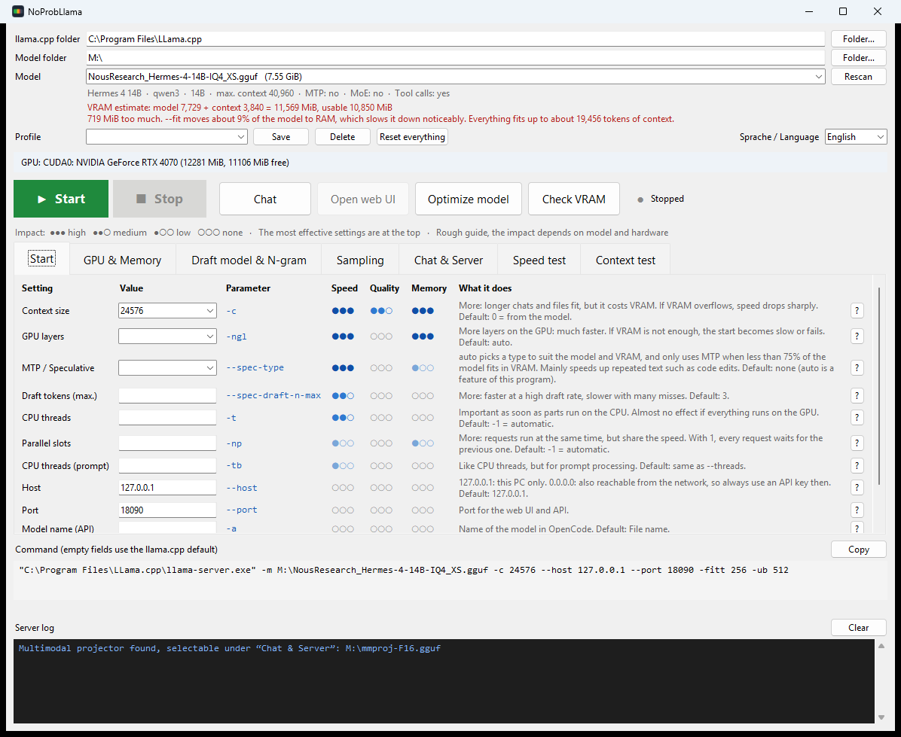
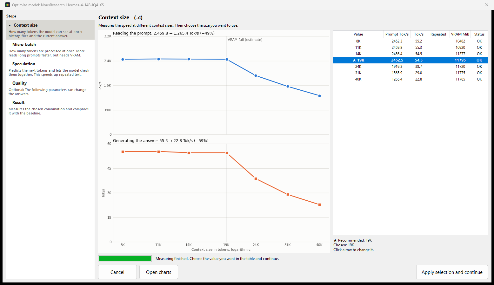
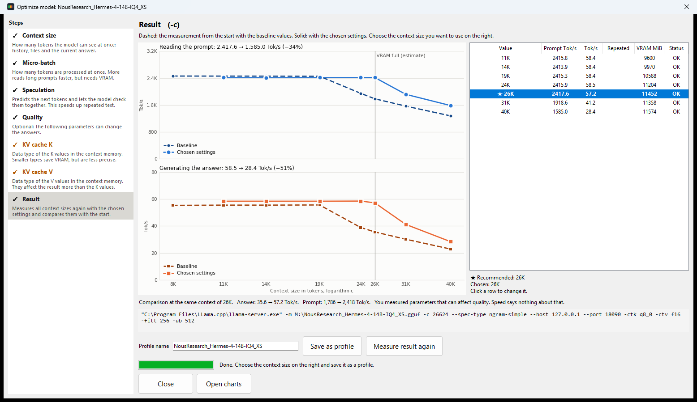
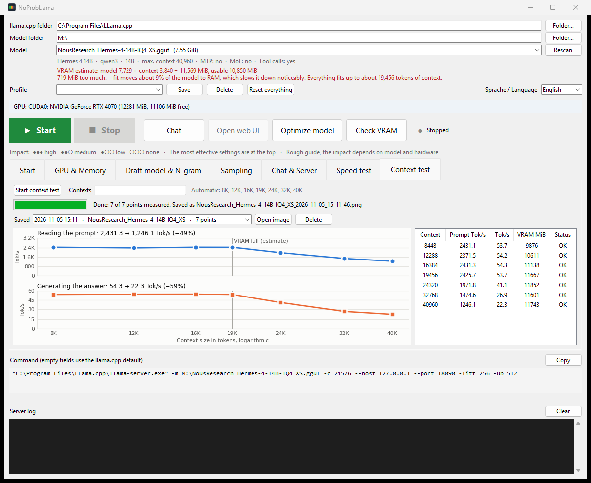
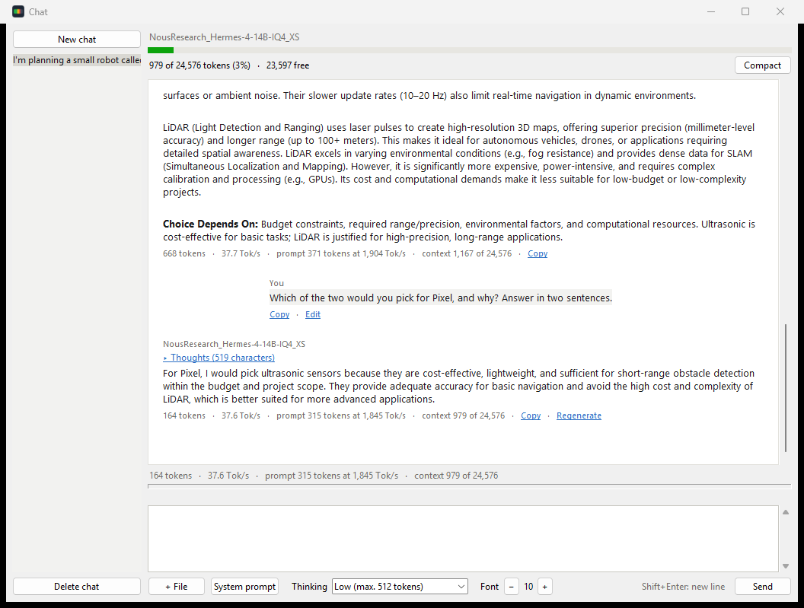

# NoProbLlama

*No problem, Llama.*

**English** | [Deutsch](README.de.md)

NoProbLlama gets more out of your local AI models. Instead of trying start options one at a time by hand, you test them systematically: the **Optimize model** wizard measures the context size and the most important parameters one after the other, shows you the speed as curves and so guides you to the settings that make your model run as fast and as well as possible on your graphics card. It saves the best combination as a profile.

NoProbLlama is a Windows interface for [llama.cpp](https://github.com/ggml-org/llama.cpp). The program also estimates the memory needed before you start anything. For chatting, it has its own window that works without a browser and therefore saves VRAM. And as soon as the server is running, you can use the model directly in OpenCode.



## Why it is useful

On a graphics card with 8 to 16 GB, a few hundred MiB often decide whether a model runs smoothly. If part of it slips into system RAM, speed drops sharply. On top of that, `llama-server` has around a hundred start options, and which of them help depends on the model.

NoProbLlama mainly answers five questions:

- **Which settings are fastest for my model?** The Optimize model wizard measures that.
- **Does the model fit in my VRAM with this context?** You can see that before you start.
- **How much speed does more context cost me?** The context test measures that.
- **How do I keep as much VRAM and context as possible for the model?** That is what the lean chat window is for.
- **How do I use the model in OpenCode?** Choose the model, press Start, done.

## Features

### Optimize model

Start the wizard with the **Optimize model** button in the top bar. On the left, each step explains what the parameter means.



1. **Context size (`-c`):** You set the range to measure, for example from 8k to 260k. The program places up to 7 measuring points in it, one of them at the estimated VRAM limit. The range is checked against the model's maximum: if "To" is above it, the program only measures up to the maximum and tells you so. You then see the speed and choose the size you want to use. The largest size without a noticeable loss of speed is preselected.
2. **Parameters that do not affect quality:** The program measures them one after the other and picks the best value each time:
   - `-ncmoe`, MoE models only: the highest answer speed, or the value that uses less VRAM if the speed is nearly the same. If the best value is at the edge of the series, the program keeps searching in that direction.
   - `-ub`: the fastest prompt reading that does not hurt answer speed.
   - `--spec-type`: New and repeated text are measured. It picks the fastest on repeated text that costs new text at most 5%.
3. **Parameters that can affect quality (optional):** `-ctk` and `-ctv`. Here you decide yourself what to measure and which value to use. If you do not want to risk any loss of quality, simply skip this part. The measurement only shows speed, not quality, so check the result with your own tasks.
4. **Result:** Finally, the program measures the context sizes once more, this time with all chosen settings. The chart shows this measurement as a solid line and the one from the start dashed in a darker shade, at the same context sizes. If a size is missing from the start, such as a new VRAM limit after smaller KV types, the program measures it with the baseline values. This way you see for every context size what your settings bring. You choose the size on the right, and below it are the start command and the button to save everything as a profile with the name of the model. The profile is then available in the main window too. All sizes from the start are measured again, which takes a few minutes.



The example shows Hermes 4 14B (IQ4_XS) on an RTX 4070 with 12 GB. With the baseline values, speed drops above 19K of context, presumably because VRAM overflows. `-ctk q8_0` saves about 700 MiB here, and speed then holds up to 26K. At 26K, the answer therefore goes from 35.6 to 57.2 Tok/s and prompt reading from 1,786 to 2,418 Tok/s. This measurement does not show whether `q8_0` changes the quality.

The individual steps can also reveal a lot. In the same run, `ngram-simple` raised the speed on repeated text from 53 to 1,011 Tok/s, without slowing down new text. In another run with Hermes 3 8B (Q6_K), the answer fell to 1.9 Tok/s at 47K of context with `-ctk f16`, and reached 67 Tok/s with `q8_0`.

**Good to know:**

- You can use the list on the left to go back to an earlier step at any time and click a different value there. When you return to the result, it is measured again with the new selection. The program does not repeat the steps in between. Their recommendations can shift, though, if a change leaves more or less VRAM free. For that, every earlier step has a **Measure again from here** button, which measures all later steps once more.
- Each step saves its chart and measurements to `kontext_tests/optimierung/` right away. What was measured stays saved even if you cancel.
- If a server is running, it is stopped for the measurements and restarted afterwards.
- Every measuring point reloads the model. In the tests, a full run took just under 10 minutes with Hermes 4, and a good 12 minutes with a 26 GB MoE model and a shortened context list. The time for your decisions comes on top. Prompt reading and the answer now end after about 10 seconds each. So even a point where VRAM overflows, and reading would otherwise take over a minute, costs hardly more time than the others. With a 26 GB MoE model, the result step took just under 5 minutes for 8 context sizes.
- Each point is measured only once, so differences of a few percent can be chance.
- Copying code shows the best case for `--spec-type`. In everyday use the gain is smaller, because text repeats exactly less often.

### Setting parameters by hand

- **All important options:** 95 `llama-server` options in 5 tabs, with the most effective ones at the top.
- **A rating for every option:** Dots show how strongly it can affect speed, quality and memory. The `?` next to it explains the option. The dots are a rough guide, not measurements for each individual model.
- **Model data:** The program reads layers, experts and context sizes directly from the GGUF file, without loading the model.
- **Automatic suggestions:**
  - Speculative decoding (`--spec-type auto`) is chosen to suit the model.
  - For MoE models, the program calculates how many expert layers fit in VRAM. You can apply the suggestion with one click.
- **Warnings:** The program warns you about missing model parts, options without effect, a context above the training value or a server on the network without an API key, for example.
- **Profiles:** Settings can be saved and loaded again. You can copy the finished start command at any time.

### Estimating memory needs

- **VRAM estimate:** It adds up the model, context and extras and compares the sum with the free VRAM. It also shows the context size up to which everything fits. For the context, it takes the configured data types into account (for example `-ctk q8_0`).
- **Context table:** It shows how much memory different context sizes take up for the selected model.
- **VRAM check:** It shows which programs are currently using graphics memory and how much of it can be freed. It does not stop any programs, that is up to you.

The estimate can be off: in the measurements so far by up to about 300 MiB, and by more with MoE models.

### Individual measurements



The example shows Hermes 4 14B (IQ4_XS) on an RTX 4070 with 12 GB: up to about 19,000 tokens of context, the answer speed stays at around 54 Tok/s. Above that, VRAM gets tight, and at 40,960 tokens it is only 22.3 Tok/s.

- **Speed test:** Start it with the button in the tab of the same name. On the running server, it measures how fast the model reads a prompt of up to 8,000 tokens and how fast it answers. Prompt reading and the answer end after about 10 seconds each, so the whole test usually takes 10 to 25 seconds. The results are saved in the history.
- **Context test:** It restarts the server for each selected context size and measures both values. Prompt reading and the answer end after about 10 seconds each, because the speed has settled by then. The result appears as two charts on top of each other and is saved as an image. This shows you at which context size the speed drops.

### Built-in chat window



You need neither a browser nor a coding agent to chat. The chat window talks directly to the server, which saves in two ways:

- **VRAM:** A browser uses graphics memory. In one measurement, Chrome with all its open tabs used 140 to 205 MiB, while Windows reports 0 MiB for the chat window. This is mainly worthwhile on small cards, when the model only just fits and you close the browser completely for it. The answer speed was the same with and without the window.
- **Context:** Coding agents like OpenCode or Open Interpreter send their instructions and tool descriptions with every message. With OpenCode, 7,000 to 8,000 tokens were already in use after the first message. With a context of 8,192 tokens, that leaves hardly anything. In the chat window, a short first question costs about 30 tokens.

In the chat window you can also:

- read answers as they are written, with Markdown, tables and code blocks you can copy
- read formulas (as Unicode text, not as real typesetting)
- set thinking in levels and expand the thoughts when you want to see them
- attach text files, and images if the model can read them
- edit messages, regenerate answers, set a system prompt and change the font size
- drag the input field larger for longer texts and scroll inside it
- see the context in use as a colored bar with exact numbers
- **compact** the chat: at the press of a button, the model summarizes the chat so far, and a hint shows you when this is worthwhile. The old history stays readable, and you can undo the step. A summary can lose or distort details, so it is worth taking a look at it.

### Connecting OpenCode

As soon as the server is running, you can use the model in OpenCode without adjusting the configuration yourself. NoProbLlama adds the server as a provider in `~/.config/opencode/opencode.json`, setting the context size and a suitable output limit. Your other entries stay unchanged, and the previous file is backed up as `.bak`. If OpenCode Desktop is open, it picks up the change without a restart.

### Language

The interface is available in English and German. On first start, it follows the Windows language: German on a German Windows, otherwise English. You can change it at the top right of the main window under **Sprache / Language**. The program restarts to apply it.

To add another language, copy `lang/en.json`, name the copy after the language code (for example `lang/fr.json`) and translate the values. The German keys stay unchanged, and placeholders like `{name}` have to stay in place. The file appears in the selection by itself on the next start. Anything not yet translated is shown in German.

The test texts of the measurements stay the same in every language, so that results remain comparable.

## Requirements

- **Windows.** Tested with Windows 11. The program uses Windows functions and therefore does not run on other systems.
- **Python 3 with Tkinter.** Tested with Python 3.13.
- **llama.cpp** as a [Windows release](https://github.com/ggml-org/llama.cpp/releases): with the CUDA runtime for NVIDIA cards, for AMD cards as a Vulkan build, for example. Tested with build 12054 (CUDA). Options can change in newer builds.
- **Models** in GGUF format.
- **matplotlib** (optional) for the charts. Without the package, all measurements still run, and the values just appear in the table.

```bash
py -m pip install matplotlib
```

NoProbLlama was developed and tested with an RTX 4070 with 12 GB, mainly with Hermes 3, Hermes 4 and Qwen. Other NVIDIA cards should work the same way. AMD cards have not been checked on real hardware so far. The program only controls `llama-server`, but without `nvidia-smi` the totals in the VRAM check and the VRAM values in the measurements are missing. With several graphics cards, the estimate uses the first device reported.

## Getting started

```bash
git clone https://github.com/Atlan160/NoProbLlama.git
```

1. Double-click `Run_NoProbLlama.bat`.
2. Choose the llama.cpp folder and the model folder at the top.
3. Select a model and look at the VRAM estimate.
4. Press **Optimize model** to find suitable settings. You can also press **Start** right away and then use **Chat** or **Open web UI**.

## Where your data is stored

Everything stays on your computer, in the program folder:

| File | Contents |
|---|---|
| `llama_starter_config.json` | Paths, profiles, measurements, language |
| `llama_chats.json` | Your chats in plain text |
| `kontext_tests/` | Images of the context tests and results of Optimize model |

These files are listed in `.gitignore` and do not end up in the repository.

## Project files

| File | Purpose |
|---|---|
| `noprobllama.py` | Main window, server start, estimates, measurements |
| `llama_optimize.py` | Optimize model wizard |
| `llama_chat.py` | Chat window |
| `llama_options.py` | `llama-server` options with rating and explanation |
| `llama_plot.py` | Charts of the measurements |
| `llama_lang.py` | Language selection and translation |
| `lang/en.json` | English texts |

## License

[MIT](LICENSE): You may freely use, change and distribute the program. The copyright notice with the author's name must be kept.
